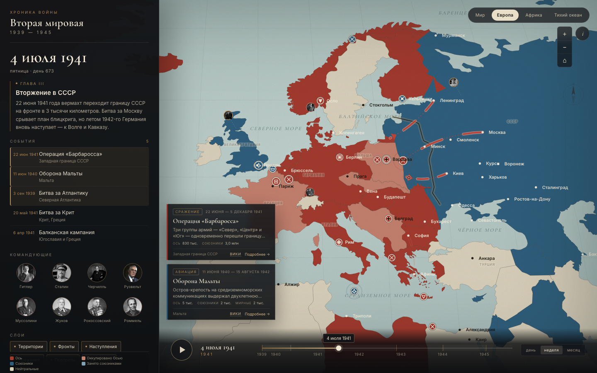
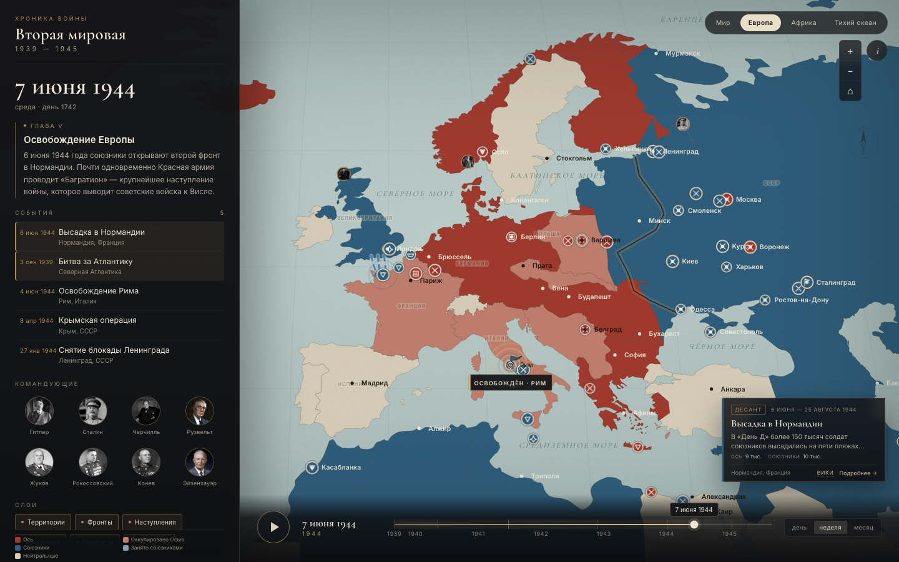
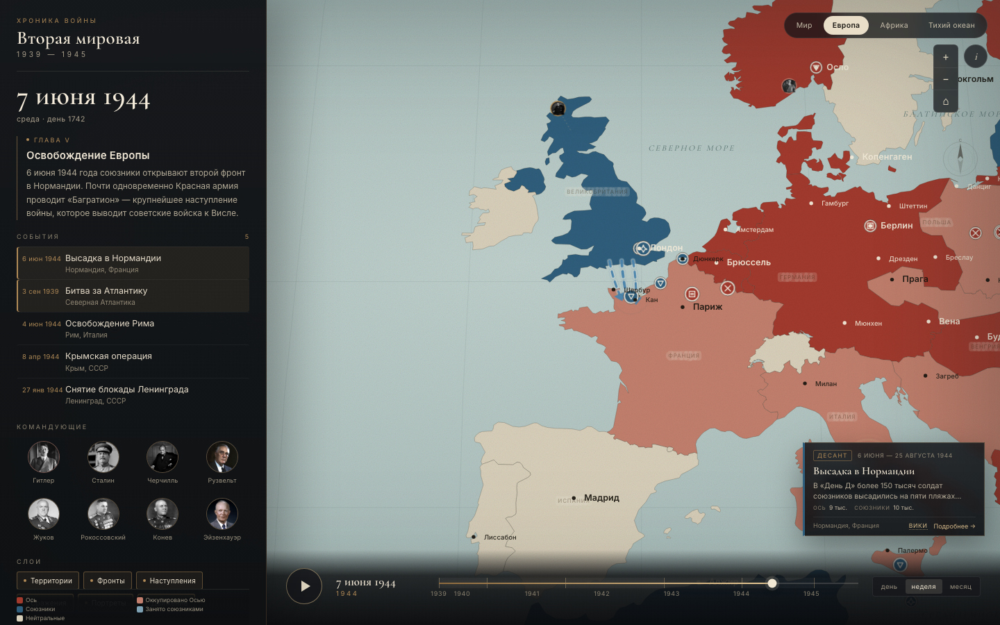
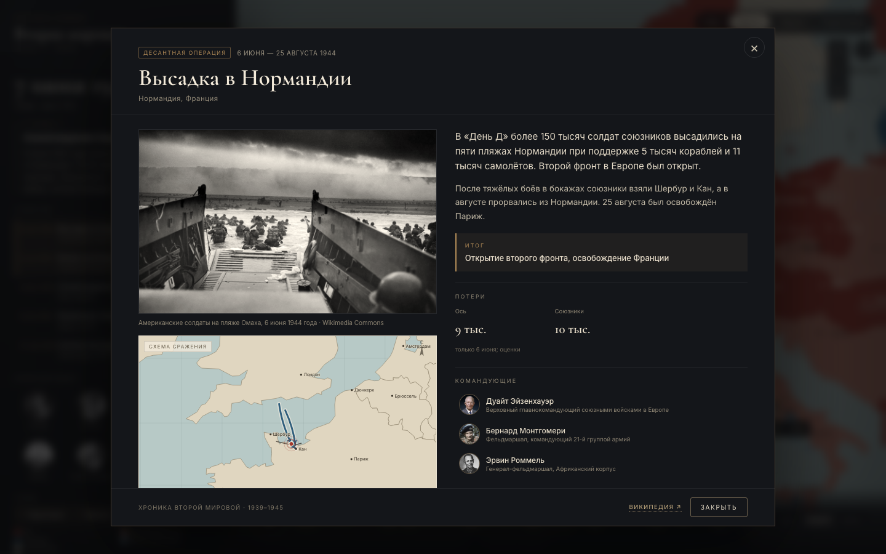
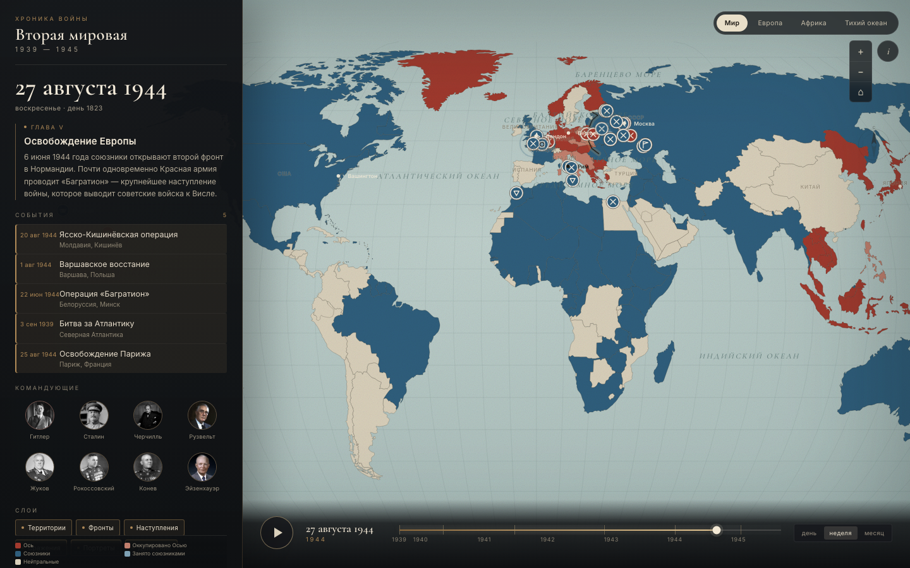
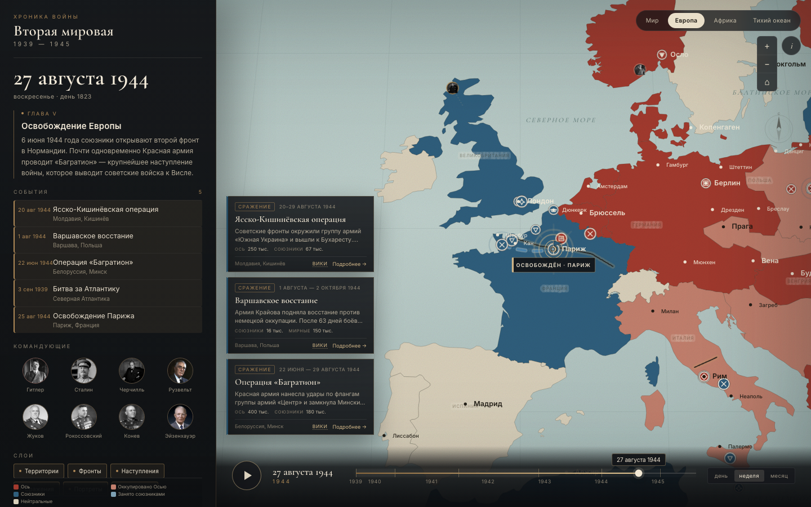

# Вторая мировая: интерактивная карта 1939–1945

**Демо:** https://oldpartisan.github.io/wwii/

**Репозиторий:** https://github.com/OldPartisan/wwii  
**Резервный деплой:** https://wwii-map.pages.dev

Современная веб-реконструкция механики проекта «Победители» (Flash, 2018), расширенная
до полного театра Второй мировой войны: от нападения на Польшу 1 сентября 1939 года
до капитуляции Японии 2 сентября 1945 года.

Карта полноэкранная, слева — информационная панель с датой, главой, событиями,
командующими и управлением слоями. Время — единый источник правды: территории,
линии фронта, стрелки наступлений, маркеры и движение синхронизированы
с глобальным таймлайном.



## Что реализовано

- **Таймлайн 1939–1945** с перетаскиванием, play/pause, скоростями «день / неделя / месяц в секунду»,
  переходом по клавиатуре и главам.
- **Территории**: страны Оси, союзники, оккупационные зоны, нейтралы; состояние меняется по датам.
- **Линии фронта**: Восточный, Западный и Итальянский фронты; интерполяция между опорными датами.
- **Стрелки наступлений**: анимированная отрисовка, привязанная к датам; GSAP-таймлайн,
  который скрабится глобальным временем.
- **Хотспоты**: 83 события — сражения, десанты, взятие городов, договоры, капитуляции.
  Модальное окно: фото, сводка, итог, потери, командующие, схема сражения с линией фронта.
- **Командующие**: слой портретов, привязанный к датам и ставкам; карточка с биографией.
- **Движение**: светящийся маркер с хвостом идёт по активным стрелкам наступления.
- **Подписи городов**: компактные, без подложки, с адаптивным контрастом — тёмные на светлом, светлые на тёмном.
- **Взятие города**: кольца, лучи, флаг и плашка «ВЗЯТ / ОСВОБОЖДЁН» в момент события.
- **Плавность**: камера, фронт, стрелки и маркеры движения используют easing и мягкие переходы.
- **Окна событий**: карточки на карте автоматически появляются в день начала события и исчезают в день окончания; в карточке видны потери сторон.
- **Справка**: в карточках событий, окон и командующих есть ссылки на Википедию.
- **Театры**: Мир, Европа, Африка, Тихий океан; в Pacific-режиме полотно обёрнуто и показывает Японию, Гавайи и Мидуэй в одном кадре.
- **Слои**: территории, фронты, наступления, сражения, портреты, движение.
- **Мобильная версия**: выдвижная панель «Хроника», полноэкранная карта, прореженные годы на таймлайне.
- **Автозапуск**: стартует через 3,5 секунды после загрузки.
- Полностью **без аудио** и **без вкладок с воспоминаниями ветеранов** — только исторические факты.



## Стек

| Слой | Решение | Почему |
|---|---|---|
| UI | React 18 + TypeScript + Vite-совместимая сборка на esbuild | быстрый старт, минимум зависимостей |
| Карта | SVG + `d3-geo` / `d3-zoom` | полный контроль над исторической геометрией, path-morphing, офлайн, без токенов |
| Спрайты | SVG-слой с ручным позиционированием | для десятков объектов достаточно, без WebGL-оверхеда |
| Анимации | GSAP (тикер времени, камера, таймлайн стрелок) | предсказуемый скраббинг и плавные перелёты |
| Состояние | Zustand | точечные подписки, без ререндера карты |
| Данные | типизированные TS-модули + GeoJSON | скорости и валидация на этапе сборки |

Почему не Mapbox/Leaflet: исторические границы 1939–45, «атласная» стилистика и морфинг
линий фронта требуют полного контроля над геометрией и стилем. Растровые тайлы и
современная политическая карта здесь только мешают.

## Деплой

### GitHub Pages

Сайт раздаётся из ветки `gh-pages` (project site `oldpartisan.github.io/wwii/`).
Сборка под подпуть делается скриптом:

```bash
node scripts/build-pages.mjs
```

Он собирает `dist/`, копирует в `dist-pages/`, переводит абсолютные `/assets`, `/data`, `/img`
в относительные и добавляет `.nojekyll`. Дальше содержимое `dist-pages/` коммитится в `gh-pages`.

### Cloudflare Pages (резерв)

```bash
pnpm build
pnpm dlx wrangler@4 pages deploy dist --project-name=wwii-map --branch=main
```

## Запуск

```bash
# Node 20+
pnpm install        # или npm install
pnpm dev            # http://localhost:5180
pnpm build          # production-сборка в dist/
```

Если pnpm блокирует postinstall esbuild:

```bash
pnpm approve-builds --all
```

## Архитектура

```
src/
  data/          # события, командующие, фронты, стрелки, главы, правила контроля
  lib/
    clock.ts     # единые часы: день войны, скорость, подписки на кадр и UI
    geo.ts       # проекция, фокус камеры, ресемплинг линий фронта
    store.ts     # Zustand: слои, театр, модалки
  components/
    MapStage     # SVG, d3-zoom, камера, композиция слоёв
    CountryLayer # заливка территорий по датам
    FrontLayer   # интерполяция линий фронта
    ArrowLayer   # GSAP-таймлайн стрелок + отрисовка
    MarkerLayer  # хотспоты
    CalloutLayer # карточка «сейчас в фокусе»
    ...
```

### Время

`clock.ts` — единственный источник времени. Он живёт на `gsap.ticker`, обновляет
`day` (float, дни от 01.09.1939) и рассылает его двум типам подписчиков:

1. **кадровые** — фронты, стрелки, спрайты: обновляют SVG императивно, без React;
2. **UI** — панель, дата, маркеры: обновляются с троттлингом ~80 мс.

Поэтому перетаскивание таймлайна не вызывает ререндер 175–184 стран и территорий и не роняет fps.

### Линии фронта

Каждая линия хранится набором опорных дат. Полилинии ресемплируются в 110 точек,
поэтому морфинг — это линейная интерполяция координат, а не тяжёлый `flubber`.
Для перемотки достаточно `seek`: состояние полностью детерминировано.

### Стрелки

Для каждой стрелки строится GSAP-твин длиной в её исторический интервал.
Общий таймлайн скрабится через `master.time(day)`, а отрисовка идёт через
`stroke-dashoffset`. Поэтому стрелка всегда соответствует дате — и при play, и при
перетаскивании, и при переходе по главам.

### Производительность

- карта и слои — SVG, но динамика обновляется вне React;
- 175–184 государства и территории мемоизированы по статусу;
- спрайты и маркеры компенсируют масштаб через `--inv`, оставаясь одного размера;
- на 1440×900 в Chromium: **~60 fps** при воспроизведении на скорости «месяц в секунду».

## Исторические границы

Карта использует четыре исторических среза:

- **1938** — довоенные границы: Германия с Австрией и Восточной Пруссией, Польша с западной
  Белоруссией и Западной Украиной, независимые Прибалтика и Финляндия.
- **1939** — после 17 сентября: восточная Польша (Кресы) переходит к СССР, западная Польша
  показывается как оккупированная.
- **1940** — после присоединения Прибалтики, Бессарабии и Карельского перешейка; именно этот
  срез используется с 1941 года, поэтому линия фронта 22 июня совпадает с границей СССР.
- **1945** — послевоенные границы и оккупационные зоны Германии, новая граница Польши,
  расширенный СССР.

Переключение: 17.09.1939, 15.06.1940 и 08.05.1945. В промежутке 1941–1944 де-факто
изменения (оккупация, фронты, аннексии) показываются цветом контроля и линиями фронта,
а не помесячной перерисовкой контуров.

Источник базовых границ: [historical-basemaps](https://github.com/aourednik/historical-basemaps) (CC BY-SA 4.0);
срезы 1939/1940 получены геометрическим объединением и вычитанием полигонов.

## Мобильная версия и Pacific

- На экранах до 760 px панель превращается в выдвижной drawer с кнопкой «Хроника».
- «Тихий океан» использует обёрнутое мировое полотно: Япония, Гавайи и Мидуэй видны в одном кадре.

## Скриншоты

| | |
|---|---|
|  |  |
|  |  |
